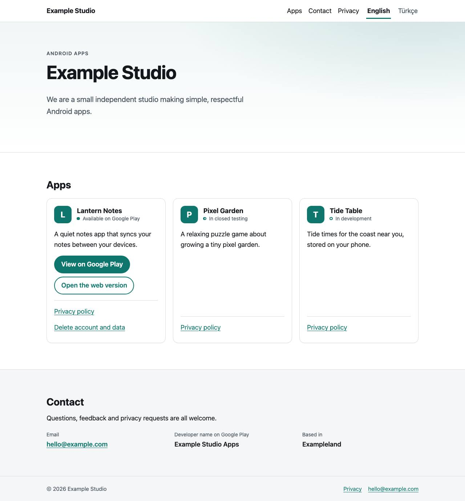
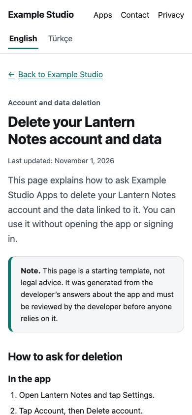

<h1 align="center">play-dev-site</h1>

<p align="center">
  <a href="https://github.com/yuroka-studio/play-dev-site/actions/workflows/ci.yml"></a>
  
  
  =24">
</p>

<p align="center">
  <a href="#quick-start">Quick start</a> · <a href="#what-google-play-requires-and-which-page-covers-it">What Play requires</a> · <a href="#deploy">Deploy</a> · <a href="#türkçe">Türkçe</a>
</p>

A small, fast, static, multilingual website for **indie developers opening a Google Play Console account**.
Edit one file, `site.config.ts`, and it generates everything Google Play asks you to host:

- a developer **home page** with a card for each of your apps,
- a **privacy policy for each app**, written from a checklist of what the app does with data,
- an **account and data deletion page** for each app that has accounts,
- a privacy policy for the **website itself**,
- localized 404 pages, a sitemap and `robots.txt`.

English and Turkish are included in full. Another language is one new messages file.





## Promises

- **No paid services.** No paid API, key or cloud service. Neither the build nor the dev server makes a network call of its own (the build passes with the network switched off); only `npm install` talks to the network, plus the one-time `npx playwright install chromium` if you run the tests. Next.js's own telemetry and its npm security-advisory check are switched off in `next.config.ts` and `scripts/next.mjs`, npm's own "new version available" check in `.npmrc`, and a test keeps all three off.
- **No tracking.** No analytics, no cookies, no local storage, no third-party embeds, no web fonts from a CDN. The tests and the build check this.
- **Free hosting.** Netlify's free tier is the main target. GitHub Pages and Cloudflare Pages work too.
- **Small.** Four runtime dependencies (`next`, `next-intl`, `react`, `react-dom`), system fonts, plain CSS, about 1 MB of output, a build of a few seconds.

> **The generated policy text is a starting template, not legal advice.** It is written from your answers and says nothing you did not tell it, but you must read it, check it against what your apps really do, and have it reviewed if the stakes call for it. Every policy page says so (see [Review the text](#review-the-text)).

## What Google Play requires, and which page covers it

| Google Play asks for | What the template generates | URL |
| --- | --- | --- |
| A **developer website** | The home page: studio, apps, contact, developer name | `/en` |
| A public **privacy policy URL for each app**: a real web page (not a PDF), open without login, naming the developer and giving a contact | One page per app, built from its data practices | `/en/apps/<app-id>/privacy` |
| For apps with accounts, a **URL where users can request account and data deletion** (plus an in-app way), saying what is deleted and what is kept | One page per app that has `hasAccount: true`: steps, what is deleted, what is kept and for how long, a ready-made mailto request | `/en/apps/<app-id>/delete-account` |
| The website's own data practices (good practice, and expected if the site collects anything) | Website privacy policy: host access logs only, no cookies | `/en/privacy` |
| For **organization accounts**, proof that you own the website | A DNS TXT record in Search Console, see [Verify your domain](#verify-your-domain-in-search-console) | (no page) |

Replace `en` with `tr` (or any language you add). Apps without accounts get no delete page: the page is not generated, so there is nothing to link to.

## Quick start

1. Click **Use this template** at the top of this repository and create your own repository (make it public if you plan to use GitHub Pages). No such button? Fork the repository, or clone it and push it to a new repository of your own.
2. Clone it and install: `npm install` (Node 22.18 or newer, but not Node 23; `.nvmrc` says 24).
3. Edit **`site.config.ts`**: your studio name, the developer name shown on Google Play, contact email, country, website URL, accent colour, and your apps. The comments in the file explain each field.
4. Preview while you edit: `npm run dev` and open <http://localhost:3000/en>.
5. Build: `npm run build`. The build **stops with a clear message while the example studio, address or sample apps are still in the output** ("Example Studio", "Exampleland", `example.com`, the three sample apps), and it deletes `out/` when it stops, so you cannot publish the placeholder site by accident. It cannot tell whether you rewrote the other texts in `site.config.ts` (the `about` text, `policyLastUpdated`, the accent colour), so read the [checklist](#before-you-paste-urls-into-play-console).
6. Deploy the `out/` folder, see [Deploy](#deploy). Then walk through the [checklist](#before-you-paste-urls-into-play-console).

### Configure `site.config.ts`

```ts
{
  id: "lantern-notes",                    // lowercase, used in the URL
  name: "Lantern Notes",
  description: { en: "...", tr: "..." },  // one entry per language
  status: "live",                         // "live" | "closed-testing" | "in-development"
  playUrl: "https://play.google.com/store/apps/details?id=...", // optional
  webUrl: "https://notes.example.net",                           // optional
  practices: {
    storage: "server",                    // "device-only" | "server"
    serverData: ["account-info", "user-content"],
    sdks: ["Firebase Crashlytics"],       // names of analytics / crash / other SDKs
    ads: false,                           // or { networks: ["Google AdMob"] }
    payments: true,                       // Google Play Billing
    permissions: [{ id: "notifications", purpose: { en: "to show reminders", tr: "..." } }],
    retention: { kind: "until-deleted" }, // or { kind: "days-after-last-use", days: 365 }
    hasAccount: true,
    identifiers: ["email", "password"],
    deletion: { inAppSteps: { en: ["..."] }, processingDays: 30, partialDeletion: true, kept: [] },
  },
}
```

TypeScript checks the shape, and `npm run build` checks the values (unique ids, valid email and URLs, accounts imply a server, and so on) with messages that say what to change.

#### How your answers become policy text

| Your answer | What the policy says |
| --- | --- |
| `storage: "device-only"` | Data stays on the device and is not sent to you; nothing is shared; nothing to delete on your side |
| `storage: "server"` + `serverData` | Lists the kinds of data sent to your server, why, how long it is kept, and a security note |
| `hasAccount` + `identifiers` | What users give you to sign up; links to the delete page; "your sign-in details" are listed as deleted |
| `sdks` | Names the third-party services and says they handle data under their own policies (empty list: says there are none) |
| `ads` | Names the ad networks, mentions the advertising ID and how to reset it (off: "no ads") |
| `payments` | Purchases go through Google Play Billing; you never see card details (off: "no in-app purchases") |
| `permissions` | Each permission with your reason for it |
| `retention` | Kept until deleted, or deleted N days after last use |
| `deletion` | Steps, completion time, backups, what is kept and for how long; retained data is disclosed |

The policy names no specific law. It uses neutral wording ("depending on where you live, you may have rights over your information").

### Review the text

Read every generated page (`npm run dev` shows them all). Every policy page carries a visible note: *starting template, not legal advice, the developer must review it*. It is part of the template (the wording is `legal.templateNotice` in `messages/*.json`). Once you have reviewed the text, or had it reviewed, set `policyLastUpdated` to the date you finished, and change it again whenever you change a policy or an app's answers.

Things the template does **not** cover, so check them yourself: apps aimed at children (Play's Families rules), the exact data your SDKs collect (read their documentation), the Play Console **Data safety** form (its answers must match your policy), and any law that applies to you specifically.

### Add a language

1. Add the code to `locales` in `site.config.ts` (for example `"de"`). Run `npm run typecheck`: it lists every text still to translate (`about`, each app's `description`, permission purposes, deletion steps ...).
2. Copy `messages/en.json` to `messages/de.json` and translate it. The policy wording is all in there; no code changes.
3. Add two rules to `netlify.toml` (a `Language` redirect for `/` and a `/de/*` 404 rule). `npm run build` prints the exact blocks if one is missing.

Want the home page in a language but not the legal text yet? Leave it out of `legalLocales` in `site.config.ts` and skip the `policy`, `websitePolicy` and `deletePage` sections in its messages file. Its app cards then link to the default-language policy pages and mark the links with the language code, for example "Privacy policy (EN)". (`npm run typecheck` still asks for that language's permission purposes and deletion steps; reusing the default-language text there is fine, since they are only shown on policy pages.)

## Deploy

`npm run build` writes the whole site to `out/`. Any static host can serve it. Use a **custom domain** on your own domain name: Play Console and Search Console work best with an address you control.

### Netlify (free tier, recommended)

Netlify reads `netlify.toml`, which already holds the build command, the publish folder, Node 24, the language redirect for `/`, localized 404 pages, security headers and cache rules. The headers include HSTS for one year for your exact domain only; it deliberately leaves out `includeSubDomains`, which would also force https on every subdomain you own (see the comment in `netlify.toml` before adding it).

1. Push your repository to GitHub.
2. In Netlify: **Add new site > Import an existing project**, pick the repository. Leave the detected settings alone (`npm run build`, publish directory `out`). Deploy.
3. **Domain management > Add a domain** and follow the DNS steps; HTTPS certificates are issued for you.
4. Check: `/` redirects to your browser's language, `/en/nope` shows the localized 404 page.

Or deploy from your machine without Git: `npm run build && npx netlify-cli deploy --dir out --prod` (it asks you to log in once). Keep the `&&`: a failed build must not be followed by a deploy.

### GitHub Pages (free for public repositories)

1. Copy `docs/deploy/github-pages.yml` to `.github/workflows/pages.yml`, commit and push.
2. In the repository: **Settings > Pages > Source: GitHub Actions**.
3. Add your custom domain under **Settings > Pages** and point DNS at GitHub as the page tells you.

What to know:

- **No language redirect.** GitHub Pages cannot read `netlify.toml`, so `/` shows a **language chooser** page instead (generated by the build, with each language's own name and intro). Every language still has its own address, such as `/en` and `/tr`.
- **Serve from the root of a domain.** Pages built for `https://<user>.github.io/<repo>/` would break the site's absolute links. Use a custom domain, or name the repository `<name>.github.io`.
- **One 404 page for everything.** Unknown addresses (including the delete page of an app without accounts) show the default-language `404.html`.
- **No custom headers.** The security headers in `netlify.toml` do not apply (the site loads nothing from other sites anyway).
- `out/.nojekyll` is written by the build; without it GitHub would drop the `_next/` folder.

### Cloudflare Pages (free)

1. In Cloudflare: **Workers & Pages > Create > Pages > Connect to Git**, pick the repository.
2. Build command `npm run build`, build output directory `out`. Node 24 is picked up from `.nvmrc` (or set the variable `NODE_VERSION` to `24`).
3. Add your domain under **Custom domains**.

What to know:

- Cloudflare Pages does not read `netlify.toml`. The build notices it is running there (`CF_PAGES=1`, or set `DEPLOY_TARGET=cloudflare`) and writes `out/_headers` from the `[[headers]]` rules, so the security headers still apply.
- There is no language redirect for `/`: visitors get the same **language chooser** as on GitHub Pages.
- Unknown addresses show the default-language `404.html`.

After any deploy, open the home page, one app policy and one delete page in a private window.

## Verify your domain in Search Console

Play Console asks **organization** accounts to prove they own their website, by linking it to the developer account through Google Search Console. Personal accounts can add a website without it, but verifying it is recommended: it ties the site you list to your account. (Google changes these rules from time to time; follow what Play Console shows you.)

A **DNS TXT record** is the easiest method here: nothing changes in this repository, it keeps working across redeploys, and it covers the whole domain.

1. Open [Google Search Console](https://search.google.com/search-console), **Add property**, and choose **Domain** (not URL prefix). Enter your domain without `https://`, for example `your-studio.example`.
2. Google shows a TXT record that starts with `google-site-verification=`. Copy it.
3. In your DNS provider (Netlify DNS: **Domains > your domain > DNS records**; Cloudflare: **DNS > Records**; or your registrar) add a record: type **TXT**, name `@` (the bare domain, sometimes left empty), value the string you copied. Save.
4. Back in Search Console press **Verify**. DNS can take minutes to hours; try again later if it fails.
5. In Play Console, follow the website-verification step of your developer account. Use the same Google account in Search Console and Play Console so the request is approved automatically.

Keep the TXT record in place; removing it can undo the verification.

## Before you paste URLs into Play Console

- [ ] `site.config.ts` holds your real developer name (exactly as on your Play listing), contact email, country and website URL.
- [ ] `npm run build` passes **without** `ALLOW_EXAMPLE`.
- [ ] Every app's `practices` match what the app really does: data sent to a server, SDKs, ads, purchases, permissions, accounts.
- [ ] You read the generated English and Turkish (or your languages) policy text, and `policyLastUpdated` is today's date.
- [ ] The site is live on your own domain over HTTPS. In a private window, open each URL you will paste: it loads without login, is a web page and not a PDF, and shows the developer name and contact.
- [ ] Play Console > **App content > Privacy policy**: paste `https://your.domain/en/apps/<app-id>/privacy`.
- [ ] Apps with accounts: Play Console > **Data safety > Data deletion**: paste `https://your.domain/en/apps/<app-id>/delete-account`, and make sure the app has its own delete-account option inside it too.
- [ ] The **Data safety** form answers match the policy (the template does not fill it in for you).
- [ ] The app links to its privacy policy inside the app.
- [ ] Developer **website** field: `https://your.domain/en`.
- [ ] Organization accounts: the domain is verified in Search Console.
- [ ] Write to your contact email from another address to be sure it arrives.

## Commands

| Command | What it does |
| --- | --- |
| `npm run dev` | Dev server at <http://localhost:3000/en> (telemetry off, no network calls) |
| `npm run build` | Static export to `out/`, then the post-build checks |
| `npm start` | Serves `out/` on <http://localhost:4100> with the redirects and headers of `netlify.toml`. Listens on this computer only; add `-- --host 0.0.0.0` to open it to your network |
| `npm run lint` / `npm run typecheck` | ESLint / TypeScript |
| `npm run test:e2e` | Playwright + axe against the built site (`npx playwright install chromium` the first time) |
| `npm test` | Build, then the tests. Needs your own `site.config.ts`: on the untouched template the build stops at the placeholder guard |
| `npm run test:example` | Build and test the template as shipped, example values included (sets `ALLOW_EXAMPLE=1` for you; the result is never deployable) |

In `npm run dev`, an address that is not generated (for example the delete page of an app without accounts) shows an error page instead of the 404; the built site answers 404.

The post-build step (`scripts/postbuild.mjs`) writes the language chooser, removes unused files, checks that every page the config implies exists and that `netlify.toml` covers every language, and runs the hygiene scan: it fails on leftover example values (unless `ALLOW_EXAMPLE=1`) and on trackers or iframe embeds (never allowed).

`ALLOW_EXAMPLE=1` exists for CI and previews of the example (`npm run test:example` sets it). When the post-build checks fail, the step deletes `out/` so a half-finished build cannot be deployed. The CI workflow in this repository sets `ALLOW_EXAMPLE`; in your own repository, delete that line from `.github/workflows/ci.yml` after you have filled in the config, so CI blocks placeholders too.

The tests (`e2e/`) check, in every language: every page returns content; policies contain the developer name and email; the delete page exists only for apps with accounts; no horizontal overflow at 320 px; axe finds no WCAG A/AA issues; no cookies, storage or third-party requests; message files stay in step; the placeholder guard works. They read `site.config.ts` and `messages/`, so they keep passing after you replace the example.

## Project layout

```
site.config.ts       the file you edit
messages/            en.json, tr.json: all UI and policy wording
app/[locale]/        home, privacy, apps/[app]/privacy, apps/[app]/delete-account, 404
lib/                 config types and checks, policy builders, colour helpers
components/          header, footer, app card, document renderer
scripts/             postbuild.mjs, serve.mjs, hygiene scan
e2e/                 Playwright + axe tests
netlify.toml         redirects, 404 rules, headers
docs/                GitHub Pages workflow, screenshots
```

---

## More from Yuroka Studio

Small, offline tools with no paid services, all MIT:

- [nightshift-agents](https://github.com/yuroka-studio/nightshift-agents): scheduled coding agents that take one task from a backlog and open a pull request with real test evidence.
- [shigley-calc](https://github.com/yuroka-studio/shigley-calc): tested machine-element calculators (endurance limit, fatigue, shafts, bolt groups) with an offline web page.
- [waveform-peaks](https://github.com/yuroka-studio/waveform-peaks): turn songs into compact waveform data for web players.
- [type-cover](https://github.com/yuroka-studio/type-cover): deterministic, code-generated typographic cover art.

## Türkçe

**play-dev-site**, Google Play Console hesabı açan bağımsız geliştiriciler için küçük, hızlı, statik ve çok dilli bir web sitesi şablonudur. Tek dosyayı, `site.config.ts` dosyasını düzenlersiniz; şablon Play'in istediği her şeyi üretir: geliştirici ana sayfası, her uygulama için gizlilik politikası, hesabı olan uygulamalar için hesap ve veri silme sayfası, web sitesinin kendi gizlilik politikası. İngilizce ve Türkçe metinler hazırdır.

- **Ücretli hizmet yok, izleme yok.** Çerez, analiz, reklam ve üçüncü taraf gömme yoktur. Derleme ve geliştirme sunucusu ağ çağrısı yapmaz (Next.js telemetrisi ve npm güvenlik bildirimi sorgusu kapalıdır); yalnızca `npm install` ağa bağlanır.
- **Hızlı başlangıç:** "Use this template" ile (düğme yoksa depoyu fork edin ya da klonlayıp kendi deponuza gönderin) kendi deponuzu oluşturun, `npm install`, `site.config.ts` dosyasını kendi bilgilerinizle doldurun, `npm run build`, ardından `out/` klasörünü yayınlayın. Örnek stüdyo, örnek adres ve örnek uygulamalar ("Example Studio" gibi) çıktıda kaldığı sürece derleme bilinçli olarak hata verir ve `out/` klasörünü siler; `about` metni ve `policyLastUpdated` gibi diğer metinleri kendiniz kontrol etmelisiniz.
- **Ücretsiz yayın:** Netlify (önerilen), GitHub Pages veya Cloudflare Pages. GitHub Pages ve Cloudflare Pages'te dil yönlendirmesi çalışmaz; kök sayfa dil seçimi sunar.
- **Alan adı doğrulama:** Kurumsal Play hesapları için zorunlu, kişisel hesaplar için önerilir. Search Console'da "Domain" özelliği ekleyin, verilen `google-site-verification=...` TXT kaydını DNS sağlayıcınıza ekleyin ve "Verify" düğmesine basın.
- **Önemli uyarı:** Üretilen politika metinleri bir başlangıç şablonudur, **hukuki tavsiye değildir**. Metni uygulamanızın gerçekte yaptıklarıyla karşılaştırıp kendiniz gözden geçirmelisiniz. İncelemeyi bitirince `policyLastUpdated` tarihini güncelleyin.
- **Play Console'a URL yapıştırmadan önce:** yukarıdaki İngilizce kontrol listesini tamamlayın. Gizlilik politikası adresi `https://alan.adiniz/tr/apps/<uygulama-id>/privacy`, hesap silme adresi `https://alan.adiniz/tr/apps/<uygulama-id>/delete-account` biçimindedir.

## Credit and license

Made by [Yuroka Studio](https://yuroka.net). Released under the [MIT license](LICENSE).
